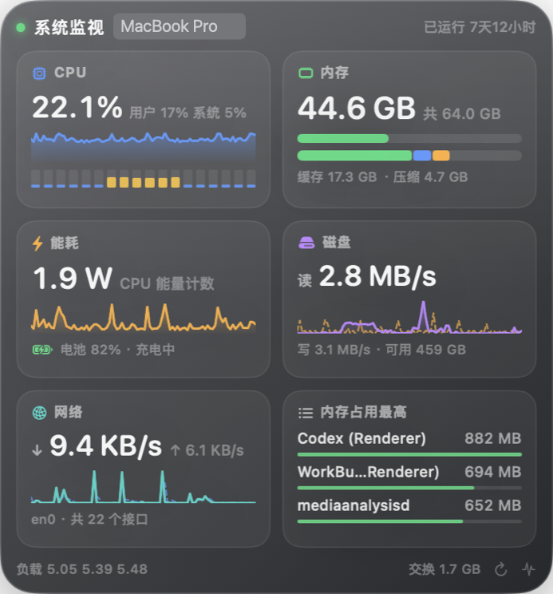
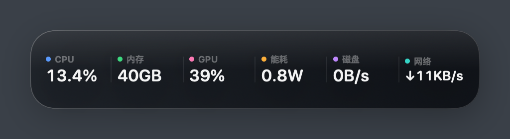
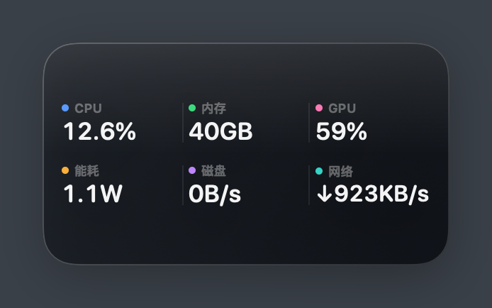
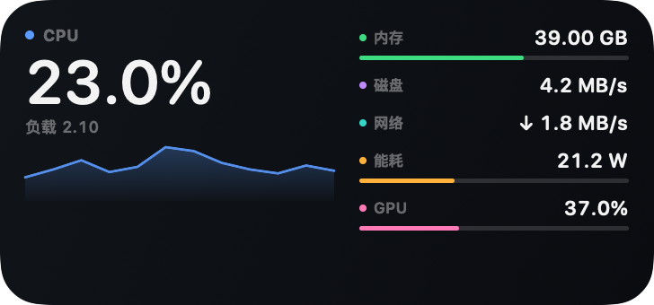
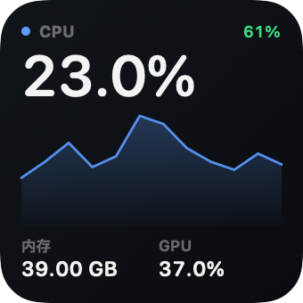
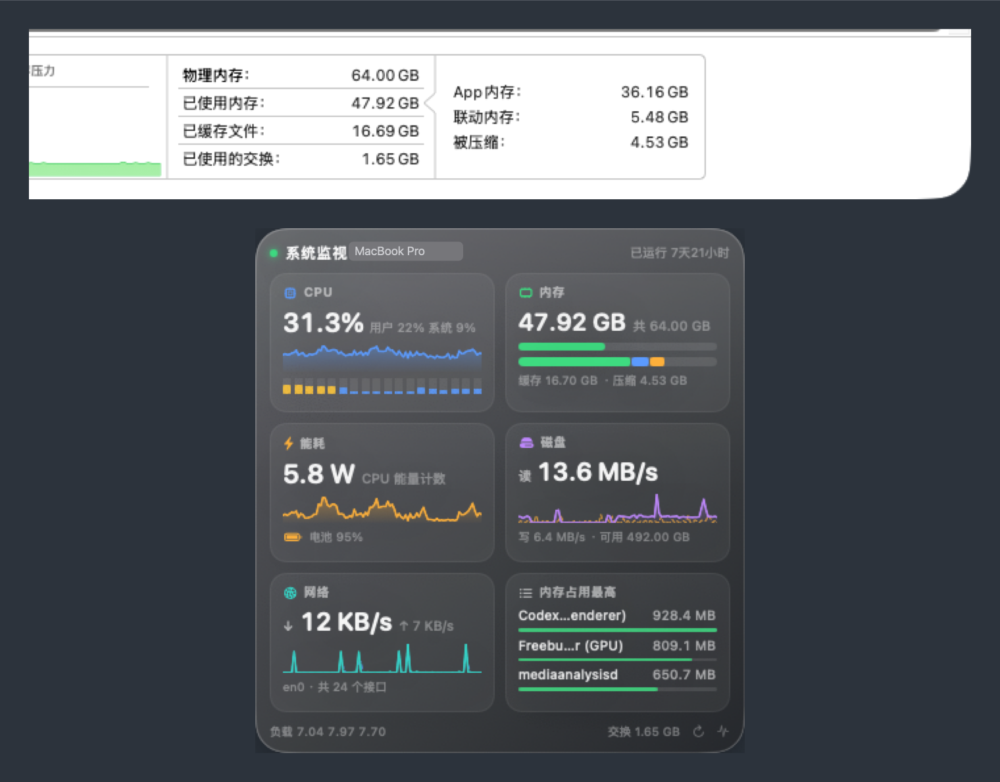

<div align="center">

[简体中文](../../README.md) · **English** · [繁體中文](README_zh-TW.md) · [日本語](README_ja.md) · [한국어](README_ko.md) · [Deutsch](README_de.md) · [Español](README_es.md) · [Français](README_fr.md) · [Русский](README_ru.md) · [Português (Brasil)](README_pt-BR.md)

# MacS

Formerly MacStats.

### Activity Monitor, pinned to your desktop.

**CPU, memory, GPU, energy, disk and network at a glance — every number matched to Activity Monitor.**

[](#install)
[](#how-it-works)
[](#commands)
[](#how-it-works)

[Install](#install) · [What it shows](#what-it-shows) · [Two surfaces](#two-surfaces) · [Accuracy](#how-close-it-gets-to-activity-monitor) · [FAQ](#faq) · [Limitations](#known-limitations)

**[Download MacStats.zip](https://github.com/yichensunjoe/macstats/releases/latest/download/MacStats.zip)** · drag it into `/Applications`, then right-click → Open once

</div>

---

## Install

[**Download MacStats.zip**](https://github.com/yichensunjoe/macstats/releases/latest/download/MacStats.zip) (about 2.4 MB, macOS 15+ on Apple silicon)

> **The download is called MacStats; the installed app shows up as MacS.** The release file is `MacStats.zip` and it unpacks to `MacStats.app`; Finder, Launchpad and the menu bar show MacS. Same app, and the bundle ID is still `com.macstats.app`, so preferences and widgets you already added are unaffected.

1. Unzip it and drag `MacStats.app` into `/Applications`
2. Right-click MacS → **Open** and confirm once. The build is **signed but not notarized** (notarization needs a paid Developer ID certificate); see [install notes](../install.md) for why, and for the other ways to let it through
3. The panel appears on the desktop. For the WidgetKit widget: right-click the desktop → Edit Widgets → search “系统监视” (the widget's name in the gallery)

The approval applies to that one download. After re-downloading, overwriting or upgrading you may be asked again — right-click → Open, same as before.

Step 1 is not optional: the WidgetKit extension is only discovered from `/Applications`. In the Downloads folder or `~/Applications`, MacS never shows up in the widget gallery.

**Verify the download**

Run this in the folder that holds both files (the `.sha256` is attached to the same release):

```bash
shasum -a 256 -c MacStats.zip.sha256
```

`MacStats.zip: OK` means the file is intact. If it fails, download again — do not install.

**Other ways to install**

```bash
# 1. Clear the download quarantine once, then open normally
xattr -dr com.apple.quarantine /Applications/MacStats.app
open /Applications/MacStats.app

# 2. Or use Homebrew
brew tap yichensunjoe/macstats https://github.com/yichensunjoe/macstats
brew trust yichensunjoe/macstats      # Homebrew 5+ requires trusting third-party taps
brew install --cask macstats
```

Clearing the quarantine attribute is the usual path for an open-source app that is not notarized, not a way around the system's security model. The source, the build script and the signing step are all in the repo, so you can check them or [build from source](#build-from-source) yourself.

**If it will not install**

1. **Gatekeeper blocks it**: use one of the ways above (right-click → Open, or the quarantine command), or System Settings → Privacy & Security → Open Anyway. If macOS says the app is damaged, the download is usually incomplete — verify the sha256 and download again; if the checksum passes, try the quarantine command.
2. **Wrong architecture**: the release is Apple silicon (arm64) only; it does not run on Intel Macs and there is no Rosetta build. `uname -m` should print `arm64`.
3. **macOS too old**: macOS 15 (Sequoia) or newer is required. Check with `sw_vers -productVersion`.
4. **Widget does not show up**: confirm the app is in `/Applications` (not Downloads, not `~/Applications`) and has been launched at least once, then `killall chronod NotificationCenter` and open the app again. Only one copy should be registered per Mac.
5. **Homebrew says untrusted tap**: Homebrew 5+ requires an explicit `brew trust yichensunjoe/macstats` before `brew install --cask macstats`; `brew untrust yichensunjoe/macstats` revokes it. Homebrew does not clear the quarantine flag, so the first launch may still need the right-click approval.

**Uninstall**

```bash
# Quit the app first (menu bar icon → Quit)
rm -rf /Applications/MacStats.app

# Installed with Homebrew:
brew uninstall --cask macstats
```

Preferences and the widget snapshot stay in `~/Library/Application Support/MacStats/` and `~/Library/Preferences/com.macstats.app.plist`; delete those too for a full cleanup. Remove desktop widgets from Edit Widgets; uninstalling the app clears the extension registration.

<p align="center">
  
</p>

Activity Monitor already shows everything. The problem is that it is a window: you have to open it, click a tab, bring it forward. MacStats turns the same five numbers into a dark panel that sits on your desktop, samples once per second, reflows its layout as you resize it, and also ships a WidgetKit widget for people who would rather put a small one in their desktop grid. GPU utilization and unified-memory use sit alongside them, read from the same IOAccelerator counters Activity Monitor's GPU tab uses.

It is deliberately not a bigger dashboard. The metrics are the five from Activity Monitor plus GPU utilization and unified-memory use, and beyond the numbers there is a 90-second trend line, per-core load, the memory breakdown, and the top three processes by memory. The interesting work is not the drawing — it is **making each number come out identical to Activity Monitor's**: screenshotted side by side at the same instant, memory stays within 0.2 GB and cumulative disk and network counters match byte for byte.

<p align="center">
  
  <br />
  
</p>

**Drag the panel into a strip and the minimal layout takes over.** No cards, no trend lines — six metrics in a row, sitting under the menu bar as an indicator. When the panel is too narrow for one row it folds into a 3 × 2 grid, so all six stay visible. At a one-second refresh the app costs about 1% of one core and roughly 80 MB resident (measured on arm64, macOS 26), and this tier draws the least. This is the default on a fresh install; right-click → “Expand to Standard Panel” opens the full panel, and the same item collapses it back.

> [!NOTE]
> The floating panel works out of the box. The copy in the system widget gallery needs a valid Apple Development signature and must be installed in `/Applications` — both are hard requirements of `chronod`, not preferences. See [Widget extension](#widget-extension).

## Build from source

Skip this if you installed from the zip. Requires macOS 15 or newer and the Xcode command line tools (Swift 6). No third-party dependencies, no Xcode project file.

```bash
git clone https://github.com/yichensunjoe/macstats.git
cd macstats
bash scripts/bundle.sh          # build + bundle + install into /Applications + register the widget
open /Applications/MacStats.app

# Package only, no install (→ dist/MacStats.zip)
bash scripts/bundle.sh --archive
```

On first launch a small `CPU · Memory` readout appears in the menu bar and the panel shows up on the desktop.

- Left-click the menu bar item to show or hide the panel
- Right-click the panel for: always on top, pin to desktop, click-through, refresh interval (0.5 / 1 / 2 / 5 s), new instance, one-click cleanup of idle background processes
- Drag empty space to move it, drag the bottom-right grip to resize; the layout switches between Minimal / Compact / Standard / Detailed to fit
- Preferences are stored in the app's `com.macstats.app` preference domain, so position and size survive a relaunch

## What it shows

| Metric | On the panel | How it is measured |
|---|---|---|
| CPU | Large total + user/system split + 90 s trend + per-core bars | `host_processor_info` deltas, same source as Activity Monitor |
| Memory | Used / total, pressure bar, App / Wired / Compressed breakdown, cached files | `vm_statistics64`, see [Accuracy](#how-close-it-gets-to-activity-monitor) |
| Energy | Watts derived from the CPU energy counter, battery level and charging state | `ri_energy_nj` deltas; falls back to a load-based estimate and says so when the counter is missing |
| Disk | Read / write rate, free space | Cumulative `IOBlockStorageDriver` byte deltas |
| Network | Up / down rate, primary interface | 64-bit `NET_RT_IFLIST2` counters; rates exclude `lo0` |
| GPU | Large utilization + 90 s trend + unified-memory use and core count | `PerformanceStatistics` on `IOAccelerator` (`Device Utilization %`, `In use system memory`), the same source as Activity Monitor's GPU tab |
| Processes | Top 3 by memory (top 5 on the large widget) | `ri_phys_footprint` from `proc_pid_rusage` |

<p align="center">
  
  
</p>

## 24-hour history and sustained-load alerts

Standard and expanded panels carry a “Last 24 Hours” row: CPU, memory and GPU curves, each with its
24-hour peak. The peak is clickable: it opens the time and value of that peak plus **the top three CPU
processes at that moment** (name, CPU%, memory, each with a one-line plain-language note).
Sampling stays at once per second; points are averaged per minute and written as JSONL under
`~/Library/Application Support/MacStats/history/` — each minute point also records the three busiest
processes at that time, about 0.4 MB a day, kept for 30 days by default. Settings → Monitoring
switches that to 7 / 30 / 90 days, or clears it.

Two honest limits: **GPU peaks do not list processes** (current sampling cannot get reliable per-process
GPU usage), and **history written before this version has no process records** — clicking it says
“No processes recorded then” rather than substituting today's process list.

“Sustained load alerts” is off by default. When on, CPU ≥ 90%, memory ≥ 85% or disk ≥ 90% must hold
for **three consecutive samples** before a notification fires, and each metric repeats at most every
ten minutes — a single spike never interrupts you. The notification body names the process responsible:
the CPU event takes the top CPU process, the memory event the top memory process (ranked separately);
disk events have no process attribution and report the value only.

## One-click cleanup of idle background processes

Menu bar (or panel) → "Clean up idle background processes…". It only targets **leftover orphans**: started by you, parent already gone, no controlling terminal, no children, no sockets, and no CPU activity for 10 minutes. You get the list and the reported footprint of those processes first (not how much macOS will actually reclaim); only after you confirm does it send `SIGTERM`, and anything still running after 3 seconds is left alone — it never escalates to `SIGKILL`.

Always untouched: system processes (`/System`, `/usr`, `/Library`, …), apps and their helpers (`.app/` in the path), commands attached to a tty, the frontmost app, children of a live parent, anything holding a TCP/UDP/Unix socket, the process's own children, and names on your whitelist (menu → "Cleanup whitelist", matched against both the executable name and `argv[0]`). Ticked names stay in that submenu with a ✓ so you can untick them later; "Clear whitelist" resets the list.

### Every process gets a plain-language explanation

The confirmation lists, for each process, what it is and what ending it does — for example `npm run dev` "local dev server; ending it means your local page stops and hot reload stops", or `github-mcp-server` "gives AI assistants extra tools; ending it removes one tool until you reopen that app". Unknown processes say so honestly ("a background command named X, no window or icon") instead of guessing. The wording lives in `ProcessGlossary.swift`, a pure function matched by `argv[0]` → executable name → install path.

On a busy machine it will often report nothing to clean. That is the design working, not a failure: what it does catch is orphaned `node` / `python` / script processes left behind by a crash. Zombies (state `Z`) are out of scope — they have already exited and only their parent can reap them.

Read-only check (kills nothing):

```bash
cd src && .build/debug/macstatsDiag --cleanup-dry-run
```

## Settings window

The menu bar → "Settings…" (or ⌘,) opens a standard settings window with three tabs:

| Tab | Contents |
|---|---|
| Display | Show desktop widget, panel shape (strip / standard), always on top, click-through, refresh interval |
| Cleanup | Your background processes, each with a plain-language description; tick to protect, untick to release; searchable, with manual name entry, refresh and clear |
| General | Launch at login, version |

The right-click menu keeps the everyday actions only: show/hide, expand/collapse, add widget, clean up, whitelist, Activity Monitor, settings, quit.

## Two surfaces

One sampling layer, two hosts:

| | Desktop panel | System widget (WidgetKit) |
|---|---|---|
| Refresh | Redraws every second | Scheduled by the system, roughly once a minute |
| Position | Drag anywhere, any number of instances | Desktop layout grid, follows the system |
| Entry point | Menu bar item / `open MacStats.app` | Right-click desktop → "Edit Widgets" → search "MacStats" |
| Size | Free resize, four layout tiers | Small / medium / large / extra large |
| Prerequisites | None | Valid signature + installed in `/Applications` + `_NSExtensionMain` entry point |

Want something that visibly moves: use the panel. Want something that lines up with your other widgets: use the system widget. Both read the same snapshot, so the two can never disagree.

## How close it gets to Activity Monitor

The method: put Activity Monitor and the panel on the same screen, read Activity Monitor's values through the accessibility API, and compare them against a sample taken at the same moment.

| Item | Result |
|---|---|
| Memory: used / cached / App / wired / compressed | Within 0.2 GB (Activity Monitor itself caches its view for 5 seconds) |
| Disk: cumulative read / write | Byte for byte identical |
| Network: cumulative received / sent | Byte for byte identical (decimal GB) |
| Process memory | 0.0 MB for the same PID |
| CPU | 1–3 percentage points under steady load (sampling window offset) |

<p align="center">
  
</p>

Getting there meant correcting three assumptions:

- **Cumulative network traffic has to come from the 64-bit IFMIB counters.** `ifi_ibytes` in `NET_RT_IFLIST2` only fills the low 32 bits; after the wrap this machine's 122.9 GB of `lo0` traffic read as 2.6 GB. Totals include `lo0` (Activity Monitor counts it too), while the rate columns exclude it — otherwise loopback traffic inflates the rate about sixtyfold.
- **"Used" is not "App + Wired + Compressed".** Activity Monitor's used memory is physical − (free − speculative) − file cache, and cached files are file cache + purgeable pages. Implement its definition, not the intuitive one.
- **Energy is not "Energy Impact".** That column is a dimensionless relative score and cannot be reproduced. The panel reports physical watts and labels the tile "CPU energy counter" instead of pretending the two are the same unit.

## How it works

Three layers, none of which depends on the UI:

```
MacStatsCore  sampling and conversions (pure logic, unit tested)
      ↓
WidgetData    snapshot + 90-point ring history
      ↓
SwiftUI views shared by the panel and the WidgetKit extension
```

- **Sampling**: Mach (`host_processor_info`, `host_statistics64`), IOKit (disk statistics, power sources), `sysctl(NET_RT_IFLIST2)`, `sysctl(vm.swapusage)`, libproc (`proc_listpids` / `proc_pid_rusage`). Public APIs only — no sudo, no SIP changes, no private frameworks.
- **Rate metrics are a moving average of the last five samples**, matching Activity Monitor's default 5-second window and smoothing out flicker.
- **The panel is a desktop-level `NSPanel`**: non-activating, joins every Space, never takes focus, so clicking it does not push your current window into the background.
- **Data never leaves the machine**: no network requests, no telemetry, no accounts, no user files read. Snapshots are written to a local JSON file for the widget extension and nothing else.

## Commands

| Goal | Command |
|---|---|
| Build, bundle, install | `bash scripts/bundle.sh` |
| Unit tests | `cd src && swift test` |
| Sampler self-check | `cd src && swift build && .build/debug/macstatsDiag --self-check` |
| Print raw counters | `cd src && .build/debug/macstatsDiag --raw` |
| Cleanup candidates (read-only) | `cd src && .build/debug/macstatsDiag --cleanup-dry-run` |
| JSON snapshot | `cd src && .build/debug/macstatsDiag --json` |
| Render the panel offscreen | `MacStats.app/Contents/MacOS/MacStats --snapshot docs/snapshot.png` |
| Render all four widget sizes | `bash scripts/preview-widget.sh` |

## Project layout

```
src/Sources/MacStatsCore/    sampling, memory math, ring history, formatting (no UI)
src/Sources/MacStats/        SwiftUI panel, menu bar app, context menu, offscreen rendering
src/Sources/MacStatsWidget/  WidgetKit extension: timeline provider + four view tiers
src/Sources/MacStatsDiag/    diagnostic CLI (--json / --raw / --self-check)
src/Tests/                   XCTest, 103 cases
assets/MacStats.icns         app icon (copied into Contents/Resources when bundling)
scripts/bundle.sh            release build, appex assembly, signing, install, registration
docs/                        alignment notes, architecture, requirements, screenshots
```

## Widget extension

The extension is bundled at `MacStats.app/Contents/PlugIns/MacStatsWidget.appex`, with a separate layout per size. Three things are required for it to appear in the widget gallery, and all three were found the hard way:

1. **The extension needs a valid signature and must be sandboxed.** `pkd` rejects ad-hoc signatures, and even with a real certificate an appex without `com.apple.security.app-sandbox` is dropped silently with `rejecting; … plug-ins must be sandboxed`. A free personal team certificate (Xcode → Settings → Accounts → sign in with an Apple ID) is enough.
2. **The app must live in `/Applications`, and only one copy may be registered.** `chronod` discovers hosts from the system application directory only; running from the project directory or a per-user Applications folder logs `Ignoring restricted or unknown extension`. Two registrations of the same bundle identifier make launchd create two XPC instances and `chronod` fails to reach the real process. `bundle.sh` installs and cleans up old registrations accordingly.
3. **The appex entry point must be `_NSExtensionMain`.** That is Xcode's default `LD_ENTRY_POINT`; with SwiftPM's default entry point the process starts, prints `main [WidgetBundle]`, never establishes a host XPC session, and is declared dead about 15 ms later with no crash report. `src/Package.swift` pins it through `linkerSettings`.

A sandboxed extension cannot read the host app's `UserDefaults`, so data travels as a JSON snapshot: the app writes it in its Application Support folder and mirrors it into the extension container when that container exists; if the extension cannot find a fresh snapshot it samples once itself.

Both the write and the wake-up are gated on visible change: at most once every 30 seconds, a 60-second heartbeat when the displayed numbers stay identical, and nothing at all when the extension container does not exist (no widget has been added). Idle floating-point jitter no longer causes writes or `chronod` wake-ups.

If `security find-identity -v -p codesigning` reports `0 valid identities`, the keychain is usually missing Apple's WWDR G3 intermediate — import `AppleWWDRCA-2030.cer` from Xcode's bundled resources.

After changing the extension, bump `CFBundleVersion`: `chronod` caches descriptors by version and will keep showing the old one otherwise.

## FAQ

<details>
<summary><strong>Why does the widget only update about once a minute?</strong></summary>

WidgetKit is not a render loop; it is a scheduled snapshot. A timeline provides one entry, and the system asks for the next one when it expires. The app requests `reloadAllTimelines()` only when a displayed value changes (at most every 30 seconds, with a 60-second heartbeat while idle), and `chronod` still throttles on a budget — the log says `budgeted-1`. Third-party widgets cannot refresh every second; the system clock gets that privilege, not extensions.

For live numbers, use the desktop panel, which redraws every second.

</details>

<details>
<summary><strong>Why is WindowServer missing from the top processes?</strong></summary>

Processes owned by other users (such as `_windowserver`) are not readable: `proc_pid_rusage` returns EPERM and `proc_pidinfo` returns zero bytes. Activity Monitor carries an Apple entitlement that lets it see everything. This is a permission boundary, not a miscalculation.

</details>

<details>
<summary><strong>One number still differs slightly from Activity Monitor.</strong></summary>

Activity Monitor refreshes every 5 seconds and shows the previous refresh's snapshot; the panel refreshes every second. Compared at the same instant, memory can differ by up to 0.2 GB, and rates and CPU differ by the sampling window offset. Compare again after one refresh cycle and they agree.

</details>

<details>
<summary><strong>Does it upload anything?</strong></summary>

No. No network requests, no telemetry, no accounts, and no user files are read. It reads system counters through public APIs and writes one local JSON file for the widget extension.

</details>

<details>
<summary><strong>Does it work on Intel Macs?</strong></summary>

The code only uses public APIs and should be portable, but it has been tested on arm64 only (macOS 26). The CPU and energy conversions have no calibration data for Intel. Issues with your own comparison results are welcome.

</details>

## Known limitations

- **The system widget ticks about once every 60 seconds.** That is WidgetKit's scheduling limit; no app can bypass it.
- **Energy is physical watts**, not Activity Monitor's "Energy Impact" score. The two have no unit correspondence.
- **The process list covers the current user only**, sorted by memory: the panel shows three, the sampling layer keeps up to 24.
- **Cleanup does not touch file cache or VRAM**: purging the file cache needs `sudo purge`, and VRAM is only released by quitting the app using it. The panel reads GPU utilization and memory use; it does not free them.
- **Cleanup does not handle true zombies**: a `Z` process has already exited and only its parent can reap it.
- **launchd-managed jobs come back**: even one-shot `launchctl submit` jobs are restarted (observed `runs = 2`), so cleanup only frees memory for the gap; most real services are excluded by the socket rule anyway.
- **History is local and minute-resolution**: aggregated per minute into JSONL, retained for 7 / 30 / 90 days. No cloud sync, no per-second replay.
- **Alerts cover three metrics only**: CPU / memory / disk, after three consecutive samples over the threshold, off by default. No temperature, fan or single-process monitoring.
- **No remote monitoring**: every reading and all history stay on this Mac and never go to the network.

## Documentation

Deeper write-ups are in Chinese.

- [Alignment notes](../monitor-alignment.md): how each value is matched to Activity Monitor, with measurements.
- [Architecture](../architecture.md): layers, data flow, and the trade-offs behind them.
- [Requirements](../requirements.md): scope, non-goals, acceptance criteria.

## License

Released under the [MIT License](../../LICENSE). You are free to use, modify and distribute it, including commercially, as long as the copyright notice and license text are kept.
